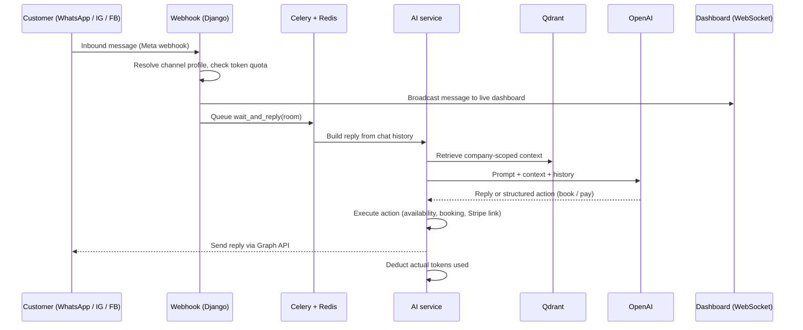

# 🌐 Multi-Channel AI Business Chat Automation Platform


An AI agent platform that answers customers on **WhatsApp, Instagram and Facebook Messenger**, using each business's own documents as its knowledge base. The agent can check availability, **book appointments**, and **send Stripe payment links** inside the chat. Businesses (tenants) manage everything from a dashboard API, and human agents can take over a conversation live.

## 🚀 Key Modules & Capabilities

### 1. 🤖 AI & RAG Engine (`Ai/`)
* **Vector Search with Qdrant**: Real-time semantic document retrieval providing context-aware responses without hallucination.
* **Knowledge Ingestion**: Upload business PDFs, catalogs, or policy documents via `/api/ai-training-files/` to automatically chunk, embed, and synchronize with Qdrant.
* **Analytics**: Question leaderboard identifying the most frequent customer inquiries for business intelligence.

### 2. 💬 Omnichannel Messaging (`Socials/`)
* **Unified Webhook Router**: `/webhook/{platform}/` normalizes inbound payloads from Meta platforms (Facebook, Instagram, WhatsApp).
* **Real-Time WebSockets**: Powered by Django Channels and Redis for instant back-office agent-to-customer live chat.
* **Customer Profile Tracking**: Automatically captures customer metadata, past interactions, and channel identities.

### 3. 💳 Financial Suite (`Finance/`)
* **Stripe Subscriptions**: Tiered subscription plans with automated checkout sessions and recurring lifecycle handling.
* **Stripe Connect**: Marketplace onboarding allowing tenant companies to accept customer payments directly.
* **Webhook Listeners**: Cryptographically verified Stripe event processing for renewals, invoices, and charge failures.

### 4. 🏢 Company Operations & Scheduling (`Accounts/`, `Others/`)
* **Google Calendar Synchronization**: Sync client bookings and working hours directly with Google Calendar via OAuth2.
* **Role-Based Access Control (RBAC)**: Manage employee roles, departmental permissions, and audit logs.
* **Support Ticket Desk**: Lifecycle management for customer support tickets from creation to resolution.

---

## What the agent does

- **Answers from the business's own data (RAG).** Answers are grounded in the company's knowledge base entries, uploaded PDF/DOCX files, services, opening hours and profile, retrieved from Qdrant.
- **Qualifies and books.** It collects the service, date/time and customer email, checks real availability, and creates the booking. It refuses to book in the past or with missing details.
- **Takes payment.** After a booking (or on request) it generates a Stripe Checkout link for the service and sends it in the chat.
- **Replies in the customer's language.** It detects the language of the incoming message and answers in it, in the tone the business configured.
- **Hands off to humans.** Staff see conversations in real time over WebSockets and can switch the bot off per chat room or per channel.

## How a message flows



Messages that arrive in quick succession are batched by the Celery task so the agent replies once to the whole burst instead of once per message.

## AI design

| Concern | Approach |
|---|---|
| Models | OpenAI `gpt-4o` for chat replies, `text-embedding-3-small` for embeddings, `gpt-4o-mini` for analytics |
| Retrieval | Qdrant vector search, every document tagged with `company_id` and filtered on it so tenants never see each other's data |
| Chunking | 700-character chunks with 150 overlap (LangChain text splitters) |
| Ingestion | Knowledge base entries, uploaded PDF/DOCX files, services, opening hours and company profile are re-synced to Qdrant on demand |
| Actions | The model returns structured JSON (`create_booking`, payment link), and the backend validates fields before executing anything |
| Availability | Computed from opening hours, existing bookings, service duration, company time zone and a per-company concurrent-booking limit |
| Prompts | Versioned in the repo (`Ai/last_working_prompt.md`, `Ai/prompt_archive.txt`) |

### Cost control

Running an LLM per message costs money, so usage is metered per tenant:

- A **quota check** runs on every inbound message, before any model call.
- **Actual input and output tokens** from each completion are deducted from the company's subscription balance.
- When a balance runs out, the company's bots are **automatically deactivated** and a real-time alert is pushed to their dashboard, so a runaway conversation can't create an unbounded bill.
- Chat history sent to the model is capped to the last 20 messages.

## Features beyond the agent

- **Billing:** Stripe subscription plans with tiered token allowances, Checkout sessions, and signature-verified Stripe webhooks. Stripe Connect lets each tenant accept payments for its own services.
- **Scheduling:** Bookings, opening hours, Google Calendar sync (OAuth2), and reminder tasks by email/SMS.
- **Support desk:** Ticket lifecycle for customer support.
- **Auth and roles:** Email OTP, JWT, Google and Apple sign-in, employee accounts with granular permissions, and session tracking.
- **Analytics:** Dashboard metrics and a "most asked questions" leaderboard.
- **Platform admin:** A separate admin API for approving channels, plan requests and tenant management.
- **Audit:** Model change history via `django-simple-history` and a user activity log.

## Tech stack

Python 3.12 · Django 5.2 · Django REST Framework · Django Channels (ASGI) · Celery + Celery Beat · Redis · PostgreSQL · Qdrant · LangChain · OpenAI API · Stripe · Meta Graph API (WhatsApp Business, Instagram, Messenger) · Google Calendar API · AWS S3 · Docker Compose · Gunicorn + Uvicorn · Nginx · drf-spectacular (OpenAPI)

## ⚡ Architecture & Subsystems

```
                                 ┌──────────────────────────────────────────────────────────┐
                                 │                OMNICHANNEL WEBHOOKS                      │
                                 │       Facebook  •  Instagram  •  WhatsApp               │
                                 └────────────────────────────┬─────────────────────────────┘
                                                              │
                                                              ▼
                                 ┌──────────────────────────────────────────────────────────┐
                                 │              CENTRAL ROUTER & CHANNELS                   │
                                 │             Django 5.2 + Django Channels                 │
                                 └──────────────┬────────────────────────────┬──────────────┘
                                                │                            │
                        ┌───────────────────────┴──────┐      ┌──────────────┴──────────────┐
                        ▼                              ▼      ▼                             ▼
         ┌─────────────────────────────┐ ┌───────────────────────────┐ ┌────────────────────────────┐
         │          AI CORE            │ │       FINANCE SUITE       │ │      OPERATIONS & SYNC     │
         │  • LangChain + OpenAI       │ │  • Stripe Subscriptions   │ │  • Google Calendar Sync    │
         │  • Qdrant Vector DB (RAG)   │ │  • Stripe Connect Vendors │ │  • Service Bookings        │
         │  • Doc Ingestion (PDF/Docx) │ │  • Automated Invoicing    │ │  • RBAC & Support Tickets  │
         └─────────────────────────────┘ └───────────────────────────┘ └────────────────────────────┘
```

---

## Project layout

```
Verseai/          Project config: settings, ASGI, Celery, root URLs
Socials/          Channel profiles, rooms, messages, webhooks, WebSocket consumers
Ai/               RAG ingestion, AI service (retrieval, prompts, actions), analytics
Others/           Bookings, calendar sync, knowledge base, tickets, Celery tasks
Finance/          Plans, subscriptions, payments, Stripe checkout and webhooks
Accounts/         Users, companies, employees, OTP, RBAC permissions
admin_dashboard/  Platform-level admin API
templates/        Email templates and OAuth redirect pages
```

## API overview

Interactive docs are served at `/api/docs/` (Swagger) and `/api/docs/redoc/` once the app is running.

| Area | Base path | Examples |
|---|---|---|
| Auth | `/api/auth/` | login, OTP, Google/Apple login, sessions |
| Chat | `/api/chat/` | chat profiles, message history, question leaderboard |
| Finance | `/api/finance/` | plans, checkout, subscriptions, Stripe Connect onboarding |
| Operations | `/api/` | bookings, opening hours, knowledge base, AI training files, tickets, calendar |
| Admin | `/api/admin/` | dashboard, users, companies, channel approval |
| Webhooks | `/api/webhook/<platform>/` | Meta ingress for `whatsapp`, `facebook`, `instagram` |
| WebSockets | `/ws/chat/`, `/ws/alerts/`, `/ws/testchat/` | live inbox, alerts, in-dashboard bot testing |

## Running it locally

**Prerequisites:** Docker and Docker Compose, an OpenAI API key, and a Qdrant instance (a free Qdrant Cloud cluster, or `docker run -p 6333:6333 qdrant/qdrant`).

```bash
# 1. Configure environment
cp .env.example .env
# fill in at least: SECRET_KEY, DB_*, OPENAI_API_KEY, QDRANT_URL

# 2. Start the stack (database, Redis, web, Celery worker, Celery beat)
docker compose up --build db redis web celery_worker celery_beat

# 3. Create tables and an admin user
docker compose exec web python manage.py migrate
docker compose exec web python manage.py createsuperuser
```

Notes:

- The `web` service is only exposed to Nginx. To reach it directly during development, add `ports: ["8080:8080"]` to that service in `docker-compose.yml`.
- The full compose file also includes an Nginx container configured for HTTPS with Let's Encrypt certificates (`default.conf`), which is how it ran in production.
- Meta webhooks need a public HTTPS URL. For local testing, tunnel with a tool such as ngrok and register `https://<tunnel>/api/webhook/<platform>/` in the Meta developer console.
- Connecting WhatsApp, Instagram or Facebook requires your own Meta app credentials and an approved business account.

## Configuration

Environment variables read by `Verseai/settings.py` and the AI layer:

| Variable | Purpose |
|---|---|
| `SECRET_KEY` | Django signing key |
| `ALLOWED_HOSTS`, `CSRF_TRUSTED_ORIGINS`, `CORS_ALLOWED_ORIGINS` | Host and origin allow-lists (comma-separated) |
| `DB_NAME`, `DB_USER`, `DB_PASSWORD`, `DB_HOST`, `DB_PORT` | PostgreSQL connection |
| `REDIS_URL` | Django cache (the Celery broker and channel layer use the `redis` host in Compose) |
| `OPENAI_API_KEY` | Chat and embeddings |
| `QDRANT_URL`, `QDRANT_API_KEY` | Vector database |
| `STRIPE_SECRET_KEY`, `STRIPE_PUBLISHABLE_KEY`, `STRIPE_WEBHOOK_SECRET` | Stripe billing and webhook verification |
| `FB_APP_ID`, `FB_APP_SECRET`, `IG_APP_ID`, `IG_APP_SECRET`, `WHATSAPP_CONFIG_ID` | Meta apps |
| `GOOGLE_CLIENT_ID`, `GOOGLE_CLIENT_SECRET`, `APPLE_CLIENT_ID` | Sign-in and Google Calendar |
| `FIELD_ENCRYPTION_KEY` | Encryption of stored channel tokens |
| `EMAIL_HOST_USER`, `EMAIL_HOST_PASSWORD`, `DEFAULT_FROM_EMAIL`, `CONTACT_EMAIL` | Outgoing email (OTP, invitations, reminders) |
| `AWS_ACCESS_KEY_ID`, `AWS_SECRET_ACCESS_KEY`, `AWS_STORAGE_BUCKET_NAME`, `AWS_S3_REGION_NAME` | S3 media storage |
| `FRONTEND_URL`, `BACKEND_URL` | Redirect targets for payments and OAuth |

